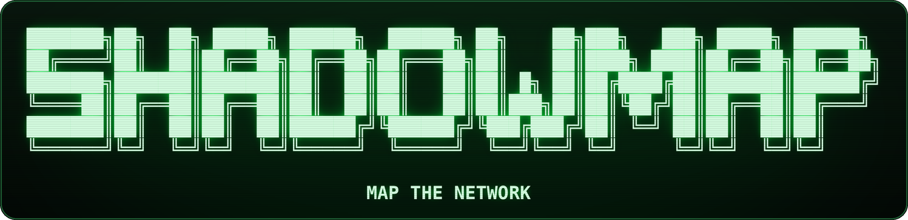
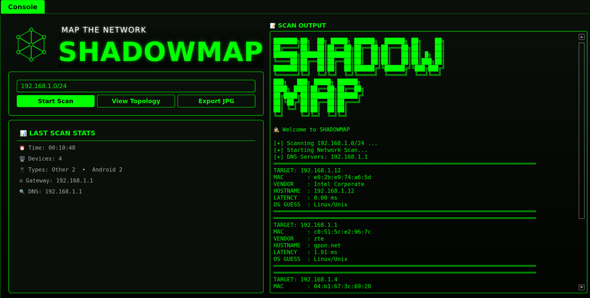
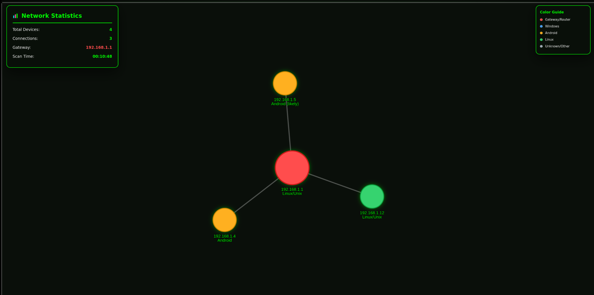
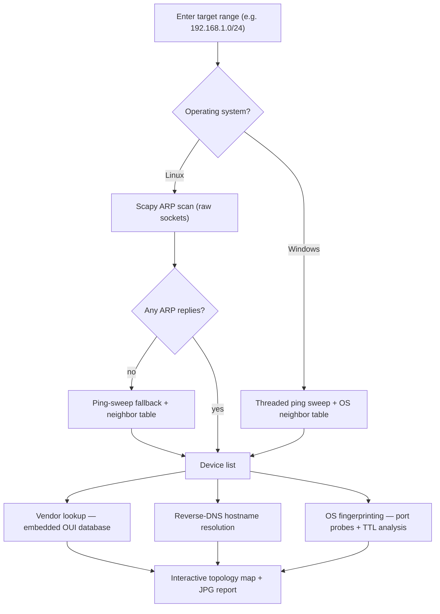

<div align="center">



**MAP THE NETWORK — a professional-grade ARP scanner with an interactive,
force-directed topology view, wrapped in a glowing green terminal UI.**

[](https://www.python.org/)
[](https://www.riverbankcomputing.com/software/pyqt/)
[](https://scapy.net/)
[](#-installation)

[](https://github.com/onlyforken637/Shadowmap/stargazers)
[](#-license)
[](#)
[](#-legal--ethical-use)

</div>

<details>
<summary><b>▣ The raw terminal banner — pure ASCII (click to expand)</b></summary>

```
███████╗██╗  ██╗ █████╗ ██████╗  ██████╗ ██╗    ██╗███╗   ███╗ █████╗ ██████╗
██╔════╝██║  ██║██╔══██╗██╔══██╗██╔═══██╗██║    ██║████╗ ████║██╔══██╗██╔══██╗
███████╗███████║███████║██║  ██║██║   ██║██║ █╗ ██║██╔████╔██║███████║██████╔╝
╚════██║██╔══██║██╔══██║██║  ██║██║   ██║██║███╗██║██║╚██╔╝██║██╔══██║██╔═══╝
███████║██║  ██║██║  ██║██████╔╝╚██████╔╝╚███╔███╔╝██║ ╚═╝ ██║██║  ██║██║
╚══════╝╚═╝  ╚═╝╚═╝  ╚═╝╚═════╝  ╚═════╝  ╚══╝╚══╝ ╚═╝     ╚═╝╚═╝  ╚═╝╚═╝

                               MAP THE NETWORK
```

</details>

---

## 📸 Screenshots

<div align="center">
<table>
  <tr>
    <td align="center"><b>🖥️ Live Console — scan results, vendor &amp; OS fingerprinting</b></td>
    <td align="center"><b>🕸️ Interactive Topology — force-directed network map</b></td>
  </tr>
  <tr>
    <td></td>
    <td></td>
  </tr>
</table>
</div>

---

## 🕵️ What is SHADOWMAP?

SHADOWMAP is a **single-file, cross-platform desktop application** that maps every
device on your local network. Type in a CIDR range (for example `192.168.1.0/24`),
press **Start Scan**, and SHADOWMAP will:

1. Discover every reachable host via **ARP** (or a parallel ping-sweep fallback),
2. Enrich each device with its **MAC vendor**, **reverse-DNS hostname**,
   **latency** and an **OS guess**, and
3. Draw the whole thing as an **interactive, animated topology graph** — gateway
   in red at the centre, every device color-coded by operating system.

Everything is bundled into one `Shadowmap.py` file — including a **52,085-entry
OUI vendor database** — so there are no data files, no downloads and no external
services. It runs fully **offline** on your machine.

---

## ✨ Features

### 🔍 Discovery & Scanning
- **ARP scan engine** — Scapy-powered ARP sweep on Linux with raw-socket precision.
- **Windows-native discovery** — ping sweep + the OS neighbor table
  (`Get-NetNeighbor` / `arp -a`); **Npcap is not required** on Windows.
- **Automatic fallback** — if ARP returns nothing, SHADOWMAP switches to a
  threaded ICMP ping sweep and reads the kernel neighbor table instead.
- **Smart large-range handling** — ranges above 1024 usable hosts are sampled
  intelligently: your own /24 and the gateway are probed first, the rest of the
  supernet is covered with an even sweep (so a stray `/16` still finishes fast).
- **Auto-detection** — default gateway, local host, local MAC and DNS servers are
  detected automatically; the host itself is added to the results as *This Host*.
- **Range sanity-check** — if the entered CIDR doesn't contain your local IP or
  gateway, the app warns you and suggests the correct `/24` to scan instead.

### 🧠 Intelligence
- **52,085-entry embedded OUI database** — resolves any MAC address to its
  manufacturer (Intel, ZTE, Samsung, Cisco…) instantly, with zero network calls.
- **Heuristic OS fingerprinting** — combines TCP port probes (SMB 445, RDP 3389,
  SSH 22, HTTP 80/443), ICMP **TTL analysis**, MAC vendor hints and
  locally-administered-MAC detection to classify devices as Windows, Linux/Unix,
  Android, iOS/macOS or Router/Switch.
- **Parallel everything** — hostname resolution, RTT pings and OS probing run on
  `ThreadPoolExecutor` worker pools; the scan itself runs on a background
  `QThread`, so the UI never freezes.
- **Live console report** — a per-device breakdown (IP, MAC, vendor, hostname,
  latency, OS guess) streams into the console while the scan runs.

### 🕸️ Visualisation
- **Interactive topology map** — a force-directed graph rendered with
  pyvis / vis-network, embedded in the app via QtWebEngine.
- **Adaptive physics** — Barnes-Hut for small networks, ForceAtlas2 for large
  ones; node size, font size and spring parameters scale with device count.
- **Color-coded nodes** — gateway/red, Windows/blue, Android/amber, Linux/green,
  unknown/silver, with a built-in legend.
- **Rich hover tooltips** — IP, MAC, vendor, hostname, latency and OS guess for
  every node.
- **On-canvas dashboard** — Network Statistics panel (devices, connections,
  gateway, scan time) plus a color guide, both overlaid on the map.
- **Physics auto-freeze** — the graph settles and locks into place after
  stabilization, so the map stays readable instead of drifting forever.

### 🖥️ Interface
- **Green-on-black "terminal" theme** — matrix-style glowing UI with a
  procedurally generated mesh logo (drop a `logo.png` next to the script to
  override it).
- **Last Scan Stats card** — time, device count, device-type breakdown, gateway
  and DNS servers at a glance.
- **Export JPG** — renders the full scan into a neat image report with one click.
- **Cross-platform polish** — font substitution for Linux, screen-size-aware
  window fitting, HiDPI zoom compensation and QtWebEngine sandbox handling are
  all built in.

---

## ⚙️ How It Works



---

## 🧠 OS Detection Heuristics

SHADOWMAP guesses the operating system from several independent signals
(`guess_os_intercepter_style()` in the source):

| Signal | Checked via | Result |
| --- | --- | --- |
| SMB (445) or RDP (3389) port open | TCP connect probe | **Windows** |
| SSH (22) port open | TCP connect probe | **Linux/Unix** |
| HTTP (80/443) port open | TCP connect probe | Network device / Web UI |
| Ping **TTL ≥ 120** | ICMP reply | **Windows** |
| Ping **TTL 50–70** | ICMP reply | **Linux/Unix** |
| Ping **TTL ≥ 200** | ICMP reply | **Router/Switch** |
| Samsung / Huawei / Xiaomi / Google / OnePlus… in MAC vendor | Embedded OUI DB | **Android** |
| Apple in MAC vendor | Embedded OUI DB | **iOS/macOS** |
| Cisco / MikroTik / Ubiquiti / TP-Link… in MAC vendor | Embedded OUI DB | **Router/Switch** |
| Locally-administered MAC + TTL 50–70 | 2nd OUI bit set | **Android (likely)** |

Signals are combined, so a device with an SMB port *and* TTL 128 is confidently
labeled `Windows`, while weaker evidence gets a `(likely)` suffix. Guesses are
computed in parallel across the whole device list.

---

## 🎨 Topology Color Guide

| Color | Device type |
| --- | --- |
| 🔴 Red | Gateway / Router |
| 🔵 Blue | Windows |
| 🟠 Amber | Android |
| 🟢 Green | Linux |
| ⚪ Silver | Unknown / Other |

The map supports **drag, zoom, hover tooltips and click-selection**; edges are
semi-transparent so large star topologies stay clean.

---

## 🚀 Installation

### Prerequisites

| Requirement | Version | Notes |
| --- | --- | --- |
| Python | 3.7 or newer | 3.10+ recommended |
| pip packages | see below | one command installs all |
| Linux | root / sudo recommended | needed for raw ARP sockets; otherwise the ping-sweep fallback is used |
| Windows | 10 / 11 | **no Npcap needed** — native discovery path is used |

```bash
pip install scapy networkx pyvis PyQt5 PyQtWebEngine
```

### 🐧 Linux

```bash
git clone https://github.com/onlyforken637/Shadowmap.git
cd Shadowmap

# create an isolated environment
python3 -m venv .venv
source .venv/bin/activate
pip install scapy networkx pyvis PyQt5 PyQtWebEngine

# root is required for Scapy's raw ARP sockets
sudo .venv/bin/python Shadowmap.py
```

> **Note:** running without `sudo` still works — SHADOWMAP automatically falls
> back to a threaded ping sweep plus the kernel neighbor table, you just may
> see fewer devices on networks that block ICMP.

### 🪟 Windows

```powershell
git clone https://github.com/onlyforken637/Shadowmap.git
cd Shadowmap

python -m venv .venv
.venv\Scripts\activate
pip install networkx pyvis PyQt5 PyQtWebEngine

python Shadowmap.py
```

> **Note:** `scapy` and Npcap are **optional** on Windows — SHADOWMAP uses a
> Windows-first discovery path (ping sweep + `Get-NetNeighbor` PowerShell
> queries) that avoids packet-capture drivers entirely. Run the terminal as
> Administrator for the most complete results.

---

## ▶️ Usage

1. **Launch** the app — you land on the *Console* tab.
2. **Type a target range**, e.g. `192.168.1.0/24`. If the range doesn't contain
   your own IP or gateway, the console suggests the correct range to scan.
3. **Start Scan** — results stream into the console in real time:

   ```
   TARGET: 192.168.1.12
   MAC       : e0:2b:e9:74:a6:5d
   VENDOR    : Intel Corporate
   HOSTNAME  : 192.168.1.12
   LATENCY   : 0.00 ms
   OS GUESS  : Linux/Unix
   ```

4. **View Topology** — opens the interactive map, maximized. Drag nodes, zoom,
   and hover for full device details.
5. **Export JPG** — saves a rendered report image (header, scan metadata and a
   full device table) anywhere you like.

**💡 Tips for the best scan**
- Scan your own LAN's `/24` — it is the fastest and most complete.
- On Linux, run with `sudo` so the ARP engine can use raw sockets.
- On Windows, allow ICMP echo in the firewall for richer latency data.
- Wi-Fi networks with *client isolation* will hide other clients from ARP.

---

## 🧱 Project Structure

```
.
├── Shadowmap.py             # The entire application — one file, zero config
├── Shadowmap-Banner.png     # Glowing neon banner shown at the top of this README
├── Shadowmap.png            # Console screenshot (used by this README)
├── Shadowmap-Topology.png   # Topology screenshot (used by this README)
├── README.md                # You are here
└── topology_animated.html   # Generated at runtime when you open the topology view
```

Optional: place a `logo.png` next to `Shadowmap.py` to replace the built-in
procedurally generated mesh logo.

---

## 🔧 Troubleshooting

| Symptom | Likely cause | Fix |
| --- | --- | --- |
| `Scapy not installed` on Linux | dependency missing | `pip install scapy` |
| Very few / no devices found | no root privileges, or client-isolated Wi-Fi | run with `sudo`; the ping-sweep fallback runs automatically |
| `Fallback neighbor table is empty` | LAN blocks ICMP + ARP | run as root/Administrator and rescan |
| Topology window is blank or crashes | QtWebEngine environment issue | flags are set automatically by the app; on Linux prefer an X11 session |
| Blurry or tiny topology labels | HiDPI scaling mismatch | already compensated on Linux at 100% scaling; adjust zoom in-app otherwise |
| `Large range detected …` message | CIDR bigger than 1024 hosts | expected behavior — smart sampling keeps it fast |
| Windows scan misses a device | firewall drops pings | allow ICMP / run as Administrator |

---

## 🛡️ Legal & Ethical Use

SHADOWMAP is intended for **authorized network auditing and education only** —
your own home lab, your company's LAN with permission, or a lab you are allowed
to scan. Scanning networks you do not own or lack explicit permission to test
may be illegal in your jurisdiction. The authors accept no liability for misuse.

---

## 🤝 Contributing

Issues and pull requests are welcome! Ideas that would fit SHADOWMAP nicely:

- [ ] IPv6 neighbor discovery
- [ ] Save / load scan sessions (JSON)
- [ ] Comparison view between two scans (new / missing devices)
- [ ] PDF export alongside the JPG report

---

## 📄 License

This project is currently **unlicensed — all rights reserved** by the author.
If you plan to reuse or redistribute the code, open an issue first. (Adding an
MIT / GPL `LICENSE` file is a good idea if you want others to contribute.)

